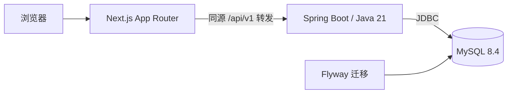

# Northstar English

一个面向个人自学、在本地运行的英语学习工作台。目标是把逐句听读、听写、精读、录音回放、写作和复习串成一条可追溯的学习路径，让进度来自真实练习记录。

**当前状态：Phase 03 桌面页面、路由与可恢复工作台已实施，等待阶段审核。** 本地提供原创 10 句课程浏览、六个 Tab、选句讲解、盲听保护、浏览位置恢复与本机文本草稿；正式播放与训练待后续阶段。素材来源审查为 `pending_review`，正式发布受阻。

[快速开始](#快速开始) · [当前功能](#当前功能) · [开发与验证](#开发与验证) · [开发路线](#开发路线) · [隐私与内容来源](#隐私与内容来源)

## 项目方向

- **本地优先**：单人使用，无注册和支付；一期不依赖 Redis、云存储或外部 AI 服务。
- **以单课闭环起步**：计划先完成原创课 *The Neighborhood Garden* 的 10 句学习流程，再扩展内容。
- **进度有证据**：浏览、播放、跳过与实际练习分别记录，不把点击按钮或跳过计为完成。
- **反馈诚实**：预置讲解明确标注来源，录音用于回放与人工自评；没有接入的模型或语音评测不会显示虚构评分。
- **桌面工作台**：后续按左侧导航、主学习区、句子助教和固定播放器组织体验，以 1440 × 900 为主要设计基准。

## 当前功能

| 功能 | 状态 |
| --- | --- |
| Next.js 页面、加载 / 成功 / 错误 / 空状态 | 已实现 |
| 浏览器 → Java API → MySQL 真实健康检查 | 已实现 |
| 专属 MySQL 容器、持久卷、迁移与运行账号分离 | 已实现 |
| Flyway 首版设置表、项目身份校验、重复迁移保护 | 已实现 |
| 项目级运行时选择、端口检查、安全启停脚本 | 已实现 |
| 原创课程入库、文本与音频接口 | 已实现本地测试版本，来源授权待审查 |
| 六页面、六 Tab、课程浏览、句子助教、刷新恢复与文本草稿 | 已实现，浏览与草稿不计练习完成 |
| 播放、听写提交、阅读、录音、写作版本、测验与复习 | 计划于后续阶段实现 |
| AI 大模型、ASR、专业发音评分 | 未接入 |

首页为 `/dashboard`，可进入 `/courses` 与原创课 `/lesson/demo-01`；环境健康检查保留在 `/settings`。工作台播放器尚未启用，草稿未正式提交，不生成练习证据。

## 技术架构



| 层次 | 技术 |
| --- | --- |
| 前端 | Next.js 16.4.2、React 19.3.1、TypeScript strict、Tailwind CSS 4.3.3 |
| 后端 | Java 21、Spring Boot 4.1.1、Spring MVC、Bean Validation、JDBC |
| 数据库 | MySQL 8.4.9、Flyway 12.4.0、独立 Docker Compose 实例 |
| 构建 | Node 22 / npm 10、npm workspaces、Maven Wrapper 3.9.9 |
| 验证 | Node 内建测试、JUnit / Mockito、真实 MySQL 集成、Playwright CLI |

这是一个单仓库、模块化单体项目。精确版本、校验摘要和选型依据见 [DEPENDENCIES](docs/DEPENDENCIES.md)。

## 快速开始

### 环境要求

当前在 **Apple Silicon Mac** 上完成验证；其他平台的完整启动流程尚未验证。

- Git、curl、Python **3.12 或更新版本**。
- Node **22.x** 和 npm **10.x**；推荐使用项目记录的 Node 22.23.2 / npm 10.9.8。
- 已启动的 Docker Desktop，支持 Docker Compose。
- Java **21**，可使用已有独立安装，或通过下方脚本下载到项目目录。

脚本仅为本项目选择运行时，不修改机器的默认 Node、Java 或其他项目配置。首次启动需要联网下载依赖和 MySQL 镜像。

### 1. 获取代码并初始化

```bash
git clone https://github.com/peninsulagiftbox/NorthstarEnglish.git
cd NorthstarEnglish

# 生成本项目独立随机密码、空闲端口和权限为 0600 的 .env。
# 已有 .env 会被保留，不会覆盖。
sh scripts/init-local.sh

# Apple Silicon：下载并校验项目级 Java 21，约 200 MB。
# 已有 Java 21 时可以跳过，在 .env 中指定 JAVA_HOME。
python3 scripts/setup-jdk.py
```

如果 Node 22 不在默认 PATH，且不在脚本支持的 Homebrew 路径，可在 `.env` 中添加运行时路径：

```dotenv
NORTHSTAR_NODE_BIN=/absolute/path/to/node22/bin
JAVA_HOME=/absolute/path/to/jdk21/Contents/Home
```

仅添加自己需要覆盖的项。配置字段见 [.env.example](.env.example)；首次初始化直接运行脚本即可，无需先复制示例文件。

### 2. 检查、构建并启动

Phase 02 启动前需要本地内容包。**公开仓库尚不分发原型 HTML 和合成音频**，仅 clone 不能完整运行本阶段；已持有冻结原型的本地工作区可先执行：

```bash
python3 scripts/extract-demo.py
python3 scripts/validate-content.py
```

提取依赖 macOS `afinfo`，不执行原型 JavaScript。文件哈希及来源说明见 [CONTENT_MANIFEST](docs/CONTENT_MANIFEST.md)。缺少材料时停止，不抓取教材或生成伪音频补位。

```bash
sh scripts/doctor.sh

# exec 仅为这一条命令注入本项目环境，不需要 source .env。
python3 scripts/local.py exec npm ci
python3 scripts/local.py exec npm run build
python3 scripts/local.py exec apps/api/mvnw -f apps/api/pom.xml verify

sh scripts/dev-up.sh
```

打开脚本输出的地址，默认是 **[http://127.0.0.1:3100](http://127.0.0.1:3100)**。在设置页显示“已连接”表示请求已通过前端转发到 Java，并真实读取 MySQL；课程页和工作台均有加载、失败与重试入口。

| 服务 | 默认地址 |
| --- | --- |
| Web | `127.0.0.1:3100` |
| Java API | `127.0.0.1:8085` |
| MySQL | `127.0.0.1:3308` |

初始化时若端口被占用，会选择其他空闲端口并写入 `.env`，以脚本输出为准。之后出现冲突会拒绝启动，请调整本项目配置；脚本不会停止占用端口的其他服务。

### 3. 停止与再次启动

```bash
sh scripts/dev-down.sh
sh scripts/dev-up.sh
```

停止操作只针对核验过身份的本项目进程与 MySQL 容器，**保留数据库容器、卷和数据**。`dev-up.sh` 会复用已有构建，缺少构建时才构建；修改源码或端口后请按下面的流程显式重建。

## 开发与验证

### 修改后重建

先停止服务，避免覆盖运行中的 JAR 或前端构建：

```bash
sh scripts/dev-down.sh
python3 scripts/local.py exec npm run build
python3 scripts/local.py exec apps/api/mvnw -f apps/api/pom.xml package
sh scripts/dev-up.sh
```

依赖发生变化时，构建前再执行 `python3 scripts/local.py exec npm ci`。

### 前端与脚本检查

```bash
python3 scripts/local.py exec npm run typecheck
python3 scripts/local.py exec npm run lint
python3 scripts/local.py exec npm test
python3 -m unittest discover -s scripts/tests -v
```

### 后端与真实数据库集成

普通 `mvnw verify` 执行单元测试，默认跳过需要数据库的集成测试。完整数据库验证使用本项目独立的 `northstar_phase01_test` schema：

```bash
sh scripts/dev-down.sh

# 只启动本项目数据库。
python3 scripts/local.py exec docker compose --env-file .env -f infra/compose.local.yml up -d --wait mysql

# 启用真实 MySQL 测试；不会清空或重建测试库。
python3 scripts/local.py db-test
sh scripts/dev-up.sh
```

`db-test` 会拒绝在本项目 API 运行时打包，测试会修改测试库的设置探针，不写入主库学习数据。

### API 与浏览器冒烟

在本项目服务运行时执行：

```bash
python3 scripts/api-smoke.py
python3 scripts/local.py exec sh scripts/browser-smoke.sh
python3 scripts/local.py exec sh scripts/content-browser-smoke.sh
python3 scripts/local.py exec sh scripts/workspace-browser-smoke.sh
```

浏览器脚本固定 Playwright CLI 版本，结果须包含 `passed: true`，截图写入本地 `output/playwright/`。首次若提示缺少浏览器，请按 CLI 提示安装 Chromium 后重跑。

Phase 01 已完成前端类型检查、lint、生产构建、7 项后端测试、4 项前端测试、6 项脚本测试，以及 API / 浏览器冒烟、真实数据库停机恢复和重启持久化核对。详细结果与失败修正记录见 [阶段报告](docs/progress/PHASE_01.md)。这些是本机验收记录，尚未在另一台全新 Mac 上独立复现。

Phase 02 的内容提取、重复播种、真实 MySQL 约束、媒体 HTTP 与浏览器实播结果见 [第二阶段报告](docs/progress/PHASE_02.md)。音频浏览器脚本使用临时测试面板，不代表工作台 UI 已实现。

## API

默认可通过 Web 的同源地址访问以下接口：

| 方法 | 路径 | 用途 |
| --- | --- | --- |
| GET | `/api/v1/health` | 查询真实数据库连接、项目标记和迁移版本 |
| GET | `/api/v1/capabilities` | 返回当前阶段及实际功能开关 |
| GET | `/api/v1/settings` | 读取已持久化的本地偏好 |
| GET | `/api/v1/books` | 四册目录占位及独立原创课 |
| GET | `/api/v1/lessons` | 当前可用原创课列表 |
| GET | `/api/v1/lessons/demo-01` | 带版本的 10 句、预置讲解、词汇、练习定义与音频 URI |
| GET | `/api/v1/audio/{id}` | 校验后的 MP3，支持 Range / 206 / 416 |
| GET | `/api/v1/licenses/{id}` | 原创声明、来源及待审查状态 |
| GET / PUT | `/api/v1/study/resume` | 浏览位置、Tab、选句与显示偏好；If-Match 防覆盖 |
| POST | `/api/v1/study/sessions` | 同规则初始化/更新单一本地浏览会话 |

成功直接返回资源，失败返回 Problem JSON（媒体 Range 的 416 可为空响应）。接口统一使用 `/api/v1`，不添加 `/api/health` 等旧路径别名；接口契约见 [openapi.yaml](docs/openapi.yaml)。

## 项目结构

```text
NorthstarEnglish/
├── apps/
│   ├── web/                    # Next.js 前端
│   └── api/                    # Spring Boot 后端、Flyway 迁移与测试
├── infra/                      # 专属 MySQL Compose 与初始化
├── content/demo-01/v1/          # 冻结原创内容、来源清单和本地音频
├── references/phase1/           # 按原文件哈希归档的参考输入
├── scripts/                    # 运行时、环境检查、启停与验证
├── docs/                       # 实施计划、版本依据、API、阶段报告
├── Northstar_English_Codex/     # 阶段提示词与可公开的设计资料
├── .env.example                # 配置示例，不含真实密码
├── package.json                # 前端 workspace 编排
└── package-lock.json           # 固定前端依赖
```

`.env`、`.local/`、构建输出和原始验收证据只在本地保存，不进入版本控制。

## 开发路线

“一期产品”是原创单课学习闭环，分为以下九个工程阶段；完成 Phase 01 不代表一期产品已完成。

| 阶段 | 范围 | 进度 |
| --- | --- | --- |
| 01 | 工程骨架、独立数据库、真实健康页 | 本机验收通过，已获准进入下一阶段 |
| 02 | 原创内容入库、课程与媒体 API | 本地验收完成，已获准进入下一阶段；素材正式发布受阻 |
| 03 | 桌面组件、路由、可恢复工作台 | 本地实施完成，待审核；详见第三阶段报告 |
| 04 | 音频引擎、句内 A–B、听写与错误来源 | 未开始 |
| 05 | 精读词汇、证据题与知识点关联 | 未开始 |
| 06 | 录音持久化、写作版本与差异 | 未开始 |
| 07 | 测验轮次、复习历史与简化调度 | 未开始 |
| 08 | 真实首页 / 报告、设置、导出备份 | 未开始 |
| 09 | 集成回归、本地发布、恢复演练 | 未开始 |

完整范围与审核边界见 [IMPLEMENTATION_PLAN](docs/IMPLEMENTATION_PLAN.md)。

## 隐私与内容来源

- **本地配置与数据**：公开仓库排除真实 `.env`、私人录音、数据库导出、备份、日志、浏览器状态、原始验收证据及个人工具配置。
- **数据库隔离**：使用专属 Compose 项目、容器、持久卷和主 / 测试 schema；迁移前校验项目身份，运行账号保留内容/设置只读，仅 `study_resume` 表可 INSERT/UPDATE。数据默认以 UTC 存储。
- **已有数据保护**：启停不删除卷，不执行 Flyway clean / repair；修改 `.env` 密码不会自动轮换持久卷中的数据库账号，不应通过清卷解决配置问题。
- **本地访问边界**：服务绑定回环地址，API 校验 Host / Origin。当前没有登录系统，适用于个人本地使用；后续写接口需要配套 CSRF 与业务校验。
- **内容来源**：本地已提取并导入原创 10 句，没有四册教材正文或录音。原型 HTML、图片和提取音频暂不公开；来源及声音授权待审查，不能将 `original` 声明当作已确认授权。Phase 02 使用本地内容包，公开 clone 的独立复现仍受素材分发限制。
- **备份边界**：完整备份与恢复工具尚未实现，当前持久卷不能替代备份。

公开范围与检查流程见 [PUBLICATION](docs/PUBLICATION.md)。仓库尚未指定开源许可证；公开可见与素材授权应分别核查。

## 常见问题

| 问题 | 检查方式 |
| --- | --- |
| 找不到 Node 22 或 Java 21 | 在 `.env` 指定项目级运行时路径，再运行 `sh scripts/doctor.sh` |
| Docker 无法连接 | 确认 Docker Desktop 已启动、当前用户可访问 Docker；不需要修改其他容器 |
| 端口冲突 | 查看 `.env` 与 doctor 输出；调整本项目端口，重建 Web 后启动 |
| 健康检查失败 / 503 | 查看本地 `.local/api.log`、`.local/web.log`，检查专属数据库是否正常运行 |
| 修改代码后页面没有变化 | 先停止本项目服务，显式重建，再启动 |
| 首次镜像下载出现 EOF | 重试同一锁定镜像；不要删除已有卷或替换其他项目容器 |

启动中途失败时，日志与已启动的本项目进程会保留，可使用 `sh scripts/dev-down.sh` 停止。更完整的环境说明见 [DEPENDENCIES](docs/DEPENDENCIES.md)，协作规则见 [AGENTS.md](AGENTS.md)。

### Phase 03 工作台与恢复

工作台 URL 保存 Tab、句子和英文/译文偏好；无查询参数时从 Java/MySQL 读取同版本恢复点。两个页面同时修改会返回 412 并提示重新载入，不静默覆盖。浏览位置以约 350ms 防抖保存；请看到“浏览位置已保存”后再关闭。听写按句、写作按课在此浏览器 localStorage 保存草稿，刷新可恢复，尚未正式提交。浏览器存储不可用时提示自行复制文本。

`dev-up.sh` 在成功执行 V003 后，核对容器和 schema 项目标记，再仅为 `study_resume` 授予 INSERT/UPDATE；`db-test` 先无 Web 启动迁移独立测试 schema，再准备同样的最小权限并运行完整测试。没有给内容、设置或项目标记写权限，不删除既有卷或数据。

生产构建使用同版 Next.js 内置 webpack：本环境的 Turbopack 辅助进程端口绑定持续失败，日志保留。依赖版本及锁文件未改动。第三阶段验证与截图见 [PHASE_03](docs/progress/PHASE_03.md)；不代表 Phase 04 的音频引擎或训练已实现。
