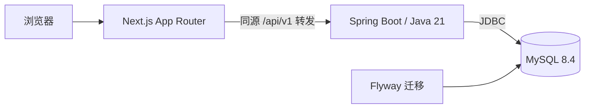

# Northstar English

一个面向个人自学、在本地运行的英语学习工作台。目标是把逐句听读、听写、精读、录音回放、写作和复习串成一条可追溯的学习路径，让进度来自真实练习记录。

**当前状态：Phase 09-R 固定候选的本地核心工程复验 PASS；公开素材授权门禁 FAIL，实体设备及另机验收 NOT VERIFIED。** 本地提供原创 10 句实播、听写、5 个源句词条、阅读提交与可追溯错误来源，以及私人录音、自动回放计次、不可变写作版本、三题测验历史与到期翻卡自评。当前默认配音为英式 Edge（Mia/Sonia、Leo/Ryan）v2，v1与历史记录保留；[评测与更换报告](docs/TTS_EDGE_EVALUATION.md)。素材来源审查为 `pending_review`，正式发布受阻。第九阶段结果与未完成验收见[阶段报告](docs/progress/PHASE_09.md)。

[快速开始](#快速开始) · [当前功能](#当前功能) · [开发与验证](#开发与验证) · [开发路线](#开发路线) · [隐私与内容来源](#隐私与内容来源)

## 项目方向

- **本地优先**：单人使用，无注册和支付；一期不依赖 Redis、云存储或外部 AI 服务。
- **以单课闭环起步**：计划先完成原创课 *The Neighborhood Garden* 的 10 句学习流程，再扩展内容。
- **进度有证据**：浏览、播放、跳过与实际练习分别记录，不把点击按钮或跳过计为完成。
- **反馈诚实**：预置讲解明确标注来源，录音用于回放与人工自评；没有接入的模型或语音评测不会显示虚构评分。
- **桌面工作台**：按左侧导航、主学习区、句子助教和固定播放器组织体验，以 1440 × 900 为主要设计基准。

## 当前功能

| 功能 | 状态 |
| --- | --- |
| Next.js 页面、加载 / 成功 / 错误 / 空状态 | 已实现 |
| 浏览器 → Java API → MySQL 真实健康检查 | 已实现 |
| 专属 MySQL 容器、持久卷、迁移与运行账号分离 | 已实现 |
| Flyway 首版设置表、项目身份校验、重复迁移保护 | 已实现 |
| 项目级运行时选择、端口检查、安全启停脚本 | 已实现 |
| 原创课程入库、文本与音频接口 | 已实现本地测试版本，来源授权待审查 |
| 六页面、六 Tab、课程浏览、句子助教、刷新恢复与文本草稿 | 已实现，浏览与草稿不计练习完成 |
| 10 句播放、真实进度 / 变速 / 循环、句内 A–B | 已实现；不是贯穿全课的波形时间轴 |
| 逐句 IndexedDB / MySQL 草稿、听写对齐、幂等作答与证据 | 已实现，错误/准确与 practiced 分开 |
| 三题测验、错误来源、到期翻卡、人工自评与源句重练 | 已实现；simple_v1 简化调度，自评不代表客观掌握 |
| 精读词汇、阅读、私人录音、写作版本 | 已实现 |
| 真实首页 / 报告、偏好设置、JSON导出预检与隔离恢复 | 已实现，媒体单独备份；详见第八阶段报告 |
| AI 大模型、ASR、专业发音评分 | 未接入 |

首页为 `/dashboard`，可进入 `/courses` 与原创课 `/lesson/demo-01`；环境健康检查保留在 `/settings`。播放器可用；草稿与正式作答分离，播放、浏览、跳过均不增加练习次数。

## 技术架构



| 层次 | 技术 |
| --- | --- |
| 前端 | Next.js 16.4.2、React 19.3.1、TypeScript strict、Tailwind CSS 4.3.3 |
| 后端 | Java 21、Spring Boot 4.1.1、Spring MVC、Bean Validation、JDBC |
| 数据库 | MySQL 8.4.9、Flyway 12.4.0、独立 Docker Compose 实例 |
| 构建 | Node 22 / npm 10、npm workspaces、Maven Wrapper 3.9.9 |
| 验证 | Node 内建测试、JUnit / Mockito、真实 MySQL 集成、Playwright CLI |

这是一个单仓库、模块化单体项目。精确版本、校验摘要和选型依据见 [DEPENDENCIES](docs/DEPENDENCIES.md)。

## 快速开始

### 环境要求

当前在 **Apple Silicon Mac** 上完成验证；其他平台的完整启动流程尚未验证。

- Git、curl、Python **3.12 或更新版本**。
- Node **22.x** 和 npm **10.x**；推荐使用项目记录的 Node 22.23.2 / npm 10.9.8。
- 已启动的 Docker Desktop，支持 Docker Compose。
- Java **21**，可使用已有独立安装，或通过下方脚本下载到项目目录。

脚本仅为本项目选择运行时，不修改机器的默认 Node、Java 或其他项目配置。首次启动需要联网下载依赖和 MySQL 镜像。

### 1. 获取代码并初始化

```bash
git clone https://github.com/peninsulagiftbox/NorthstarEnglish.git
cd NorthstarEnglish

# 生成本项目独立随机密码、空闲端口和权限为 0600 的 .env。
# 已有 .env 会被保留，不会覆盖。
sh scripts/init-local.sh

# Apple Silicon：下载并校验项目级 Java 21，约 200 MB。
# 已有 Java 21 时可以跳过，在 .env 中指定 JAVA_HOME。
python3 scripts/setup-jdk.py
```

如果 Node 22 不在默认 PATH，且不在脚本支持的 Homebrew 路径，可在 `.env` 中添加运行时路径：

```dotenv
NORTHSTAR_NODE_BIN=/absolute/path/to/node22/bin
JAVA_HOME=/absolute/path/to/jdk21/Contents/Home
```

仅添加自己需要覆盖的项。配置字段见 [.env.example](.env.example)；首次初始化直接运行脚本即可，无需先复制示例文件。

### 2. 检查、构建并启动

Phase 02 启动前需要本地内容包。**公开仓库尚不分发原型 HTML 和合成音频**，仅 clone 不能完整运行本阶段；已持有冻结原型的本地工作区可先执行：

```bash
python3 scripts/extract-demo.py
python3 scripts/validate-content.py
```

提取依赖 macOS `afinfo`，不执行原型 JavaScript。文件哈希及来源说明见 [CONTENT_MANIFEST](docs/CONTENT_MANIFEST.md)。缺少材料时停止，不抓取教材或生成伪音频补位。

```bash
sh scripts/doctor.sh

# exec 仅为这一条命令注入本项目环境，不需要 source .env。
python3 scripts/local.py exec npm ci
python3 scripts/local.py exec npm run build
python3 scripts/local.py exec apps/api/mvnw -f apps/api/pom.xml verify

# 已初始化数据库的正常启动；不会补写内容或重设课程当前版本。
sh scripts/dev-up.sh
```

Phase 10B-2 将内容初始化改为显式操作。**全新、身份已核对且内容与学习表为空的数据库**，在启动普通服务前运行一次（已有个人库禁止执行）：

```bash
python3 scripts/local.py exec java -jar apps/api/target/northstar-api-0.1.0-SNAPSHOT.jar --spring.main.web-application-type=none --northstar.content-root="$PWD/content" --northstar.initialize-content=true
```

该命令只初始化冻结 Demo、四册元信息及其原任务；不是教材发布器。已有/部分初始化库会拒绝，不会补写或重置。2026-10-28 经用户明确授权，现有个人库已从 V009.04 迁移到 V009.05，并完成本地前后端部署及只读复核；详见 [部署报告](docs/progress/PHASE_10B_2_DEPLOYMENT.md)。开发与隔离验收历史见 [PHASE_10B_2](docs/progress/PHASE_10B_2.md)。其他数据库仍需独立核对身份、备份与批准，禁止直接复用本机维护动作。

打开脚本输出的地址，默认是 **[http://127.0.0.1:3100](http://127.0.0.1:3100)**。在设置页显示“已连接”表示请求已通过前端转发到 Java，并真实读取 MySQL；课程页和工作台均有加载、失败与重试入口。

| 服务 | 默认地址 |
| --- | --- |
| Web | `127.0.0.1:3100` |
| Java API | `127.0.0.1:8085` |
| MySQL | `127.0.0.1:3308` |

初始化时若端口被占用，会选择其他空闲端口并写入 `.env`，以脚本输出为准。之后出现冲突会拒绝启动，请调整本项目配置；脚本不会停止占用端口的其他服务。

### 3. 停止与再次启动

```bash
sh scripts/dev-down.sh
sh scripts/dev-up.sh
```

停止操作只针对核验过身份的本项目进程与 MySQL 容器，**保留数据库容器、卷和数据**。`dev-up.sh` 会复用已有构建，缺少构建时才构建；修改源码或端口后请按下面的流程显式重建。

## 开发与验证

### 修改后重建

先停止服务，避免覆盖运行中的 JAR 或前端构建：

```bash
sh scripts/dev-down.sh
python3 scripts/local.py exec npm run build
python3 scripts/local.py exec apps/api/mvnw -f apps/api/pom.xml package
sh scripts/dev-up.sh
```

依赖发生变化时，构建前再执行 `python3 scripts/local.py exec npm ci`。

### 前端与脚本检查

```bash
python3 scripts/local.py exec npm run typecheck
python3 scripts/local.py exec npm run lint
python3 scripts/local.py exec npm test
python3 -m unittest discover -s scripts/tests -v
```

### 后端与真实数据库集成

普通 `mvnw verify` 执行单元测试，默认跳过需要数据库的集成测试。完整数据库验证使用本项目独立的 `northstar_phase01_test` schema：

```bash
sh scripts/dev-down.sh

# 只启动本项目数据库。
python3 scripts/local.py exec docker compose --env-file .env -f infra/compose.local.yml up -d --wait mysql

# 启用真实 MySQL 测试；不会清空或重建测试库。
python3 scripts/local.py db-test
sh scripts/dev-up.sh
```

`db-test` 会拒绝在本项目 API 运行时打包，测试会修改测试库的设置探针，不写入主库学习数据。

### API 与浏览器冒烟

在本项目服务运行时执行：

```bash
python3 scripts/api-smoke.py
python3 scripts/local.py exec sh scripts/browser-smoke.sh
python3 scripts/local.py exec sh scripts/content-browser-smoke.sh
# Phase 03 workspace-browser-smoke 保留为历史阶段脚本；Phase 04 写入型验收见下文隔离库入口。
```

浏览器脚本固定 Playwright CLI 版本，结果须包含 `passed: true`，截图写入本地 `output/playwright/`。首次若提示缺少浏览器，请按 CLI 提示安装 Chromium 后重跑。

Phase 01 已完成前端类型检查、lint、生产构建、7 项后端测试、4 项前端测试、6 项脚本测试，以及 API / 浏览器冒烟、真实数据库停机恢复和重启持久化核对。详细结果与失败修正记录见 [阶段报告](docs/progress/PHASE_01.md)。这些是本机验收记录，尚未在另一台全新 Mac 上独立复现。

Phase 02 的内容提取、重复播种、真实 MySQL 约束、媒体 HTTP 与浏览器实播结果见 [第二阶段报告](docs/progress/PHASE_02.md)。音频浏览器脚本使用临时测试面板，不代表工作台 UI 已实现。

## API

默认可通过 Web 的同源地址访问以下接口：

| 方法 | 路径 | 用途 |
| --- | --- | --- |
| GET | `/api/v1/health` | 查询真实数据库连接、项目标记和迁移版本 |
| GET | `/api/v1/capabilities` | 返回当前阶段及实际功能开关 |
| GET | `/api/v1/settings` | 读取已持久化的本地偏好 |
| GET | `/api/v1/books` | 四册目录占位及独立原创课 |
| GET | `/api/v1/lessons` | 当前可用原创课列表 |
| GET | `/api/v1/books/{id}/lessons?cursor&limit` | 真实册内课程与稳定分页，空册不生成占位课 |
| GET | `/api/v1/lessons/{id}/versions` | 可读取的版本列表及当前指针标识 |
| GET | `/api/v1/lessons/{id}?versionId=...` | 当前或指定版本的段落、句子、预置讲解与独立音频 URI |
| GET | `/api/v1/audio/{id}` | 校验后的 MP3，支持 Range / 206 / 416 |
| GET | `/api/v1/licenses/{id}` | 原创声明、来源及待审查状态 |
| GET / PUT | `/api/v1/study/resume` | 浏览位置、Tab、选句与显示偏好；If-Match 防覆盖 |
| POST | `/api/v1/study/sessions` | 同规则初始化/更新单一本地浏览会话 |
| GET / PUT | `/api/v1/drafts/{sentenceId}` | 逐句听写草稿，If-Match 冲突保护 |
| POST | `/api/v1/exercises/{sentenceId}-dictation/attempts` | 幂等听写、原文、词序对齐及证据 |
| POST | `/api/v1/study/events` | 开始 / 跳过 / 暂停，不能直接上报 practiced |
| GET | `/api/v1/study/stages` | 当前轮状态与累计真实作答次数 |
| GET | `/api/v1/reviews/items` | 待复习来源、原始尝试及课/版本/句子绑定 |

成功直接返回资源，失败返回 Problem JSON（媒体 Range 的 416 可为空响应）。接口统一使用 `/api/v1`，不添加 `/api/health` 等旧路径别名；接口契约见 [openapi.yaml](docs/openapi.yaml)。

## 项目结构

```text
NorthstarEnglish/
├── apps/
│   ├── web/                    # Next.js 前端
│   └── api/                    # Spring Boot 后端、Flyway 迁移与测试
├── infra/                      # 专属 MySQL Compose 与初始化
├── content/demo-01/v1/          # 冻结原创内容、来源清单和本地音频
├── references/phase1/           # 按原文件哈希归档的参考输入
├── scripts/                    # 运行时、环境检查、启停与验证
├── docs/                       # 实施计划、版本依据、API、阶段报告
├── Northstar_English_Codex/     # 阶段提示词与可公开的设计资料
├── .env.example                # 配置示例，不含真实密码
├── package.json                # 前端 workspace 编排
└── package-lock.json           # 固定前端依赖
```

`.env`、`.local/`、构建输出和原始验收证据只在本地保存，不进入版本控制。

## 开发路线

“一期产品”是原创单课学习闭环，分为以下九个工程阶段；完成 Phase 01 不代表一期产品已完成。

| 阶段 | 范围 | 进度 |
| --- | --- | --- |
| 01 | 工程骨架、独立数据库、真实健康页 | 本机验收通过，已获准进入下一阶段 |
| 02 | 原创内容入库、课程与媒体 API | 本地验收完成，已获准进入下一阶段；素材正式发布受阻 |
| 03 | 桌面组件、路由、可恢复工作台 | 已获准进入第四阶段；详见第三阶段报告 |
| 04 | 音频引擎、句内 A–B、听写与错误来源 | 已实施，等待阶段审核；详见第四阶段报告 |
| 05 | 精读词汇、证据题与知识点关联 | 已实施，待审核 |
| 06 | 录音持久化、写作版本与差异 | 已实施，待审核 |
| 07 | 测验轮次、复习历史与简化调度 | 已实施，等待审核；详见第七阶段报告 |
| 08 | 真实首页 / 报告、设置、导出备份 | 已实施；详见第八阶段报告 |
| 09 | 集成回归、本地发布与恢复演练 | 本地工程PASS_WITH_NOTES；完整闭环、独立MySQL/录音恢复与重启续学实测，素材授权/实体设备仍待审 |

完整范围与审核边界见 [IMPLEMENTATION_PLAN](docs/IMPLEMENTATION_PLAN.md)。

## 隐私与内容来源

- **本地配置与数据**：公开仓库排除真实 `.env`、私人录音、数据库导出、备份、日志、浏览器状态、原始验收证据及个人工具配置。
- **数据库隔离**：使用专属 Compose 项目、容器、持久卷和主 / 测试 schema；迁移前校验项目身份，运行账号保留内容/设置只读，仅 `study_resume` 表可 INSERT/UPDATE。数据默认以 UTC 存储。
- **已有数据保护**：启停不删除卷，不执行 Flyway clean / repair；修改 `.env` 密码不会自动轮换持久卷中的数据库账号，不应通过清卷解决配置问题。
- **本地访问边界**：服务绑定回环地址，API 校验 Host / Origin。当前没有登录系统，适用于个人本地使用；后续写接口需要配套 CSRF 与业务校验。
- **内容来源**：本地已提取并导入原创 10 句，没有四册教材正文或录音。原型 HTML、图片和提取音频暂不公开；来源及声音授权待审查，不能将 `original` 声明当作已确认授权。Phase 02 使用本地内容包，公开 clone 的独立复现仍受素材分发限制。
- **备份边界**：完整备份与恢复工具尚未实现，当前持久卷不能替代备份。

公开范围与检查流程见 [PUBLICATION](docs/PUBLICATION.md)。仓库尚未指定开源许可证；公开可见与素材授权应分别核查。

## 常见问题

| 问题 | 检查方式 |
| --- | --- |
| 找不到 Node 22 或 Java 21 | 在 `.env` 指定项目级运行时路径，再运行 `sh scripts/doctor.sh` |
| Docker 无法连接 | 确认 Docker Desktop 已启动、当前用户可访问 Docker；不需要修改其他容器 |
| 端口冲突 | 查看 `.env` 与 doctor 输出；调整本项目端口，重建 Web 后启动 |
| 健康检查失败 / 503 | 查看本地 `.local/api.log`、`.local/web.log`，检查专属数据库是否正常运行 |
| 修改代码后页面没有变化 | 先停止本项目服务，显式重建，再启动 |
| 首次镜像下载出现 EOF | 重试同一锁定镜像；不要删除已有卷或替换其他项目容器 |

启动中途失败时，日志与已启动的本项目进程会保留，可使用 `sh scripts/dev-down.sh` 停止。更完整的环境说明见 [DEPENDENCIES](docs/DEPENDENCIES.md)，协作规则见 [AGENTS.md](AGENTS.md)。

### Phase 03 工作台与恢复

工作台 URL 保存 Tab、句子和英文/译文偏好；无查询参数时从 Java/MySQL 读取同版本恢复点。两个页面同时修改会返回 412 并提示重新载入，不静默覆盖。浏览位置以约 350ms 防抖保存；请看到“浏览位置已保存”后再关闭。听写按句、写作按课在此浏览器 localStorage 保存草稿，刷新可恢复，尚未正式提交。浏览器存储不可用时提示自行复制文本。

`dev-up.sh` 在成功执行 V003 后，核对容器和 schema 项目标记，再仅为 `study_resume` 授予 INSERT/UPDATE；`db-test` 先无 Web 启动迁移独立测试 schema，再准备同样的最小权限并运行完整测试。没有给内容、设置或项目标记写权限，不删除既有卷或数据。

生产构建使用同版 Next.js 内置 webpack：本环境的 Turbopack 辅助进程端口绑定持续失败，日志保留。依赖版本及锁文件未改动。第三阶段验证与截图见 [PHASE_03](docs/progress/PHASE_03.md)；第四阶段增量见下文。


### Phase 04 播放、听写与复习来源

- 课文卡片之间保留12px间隔，点击整句即可选中并从头播放，选中绿底与序号高亮在暂停/结束后保留；不显示左侧竖条，悬停仅显示浅灰底，行尾不再单设播放按钮；听写目标与播放位置仍分别记录。Space 播放/暂停、J/K 上/下句、R 单句循环。输入框、按钮、链接、IME 组合及带修饰键时不截获快捷键。
- 速度按钮从1×开始，点击按1×→1.25×→1.5×→0.75×→1×循环；顺序连播、单句循环、列表循环互斥。底栏仅显示当前播放句：小点为单词起点，大点为句末标点前最后一个单词的发音结束；0秒保留音频起点，红色“终”为音频文件末尾，左右时间均为当前句时间。英式 v2 使用同次合成返回的词边界；v1没有词数据，仅显示本句起点。点击或拖动仅在当前句MP3内定位，保留播放/暂停状态；右侧设置可调模式、上/下句和句内 A–B，A–B 切换音源即清除。浏览器后台可能越过 B，不承诺采样级精度。
- 听写首次输入记录 in_progress；可开始/恢复、暂停、跳过。非空英文且成功播放目标音频后才允许正式提交；服务端验证音源、课/版本/句/题目绑定。答错也是真实练习，仍保留原文并定位遗漏/插入/替换；不当作掌握。
- 听写点击“跳过本句”，在服务端确认后进入下一句并暂停旧音频；保留原句草稿与历史，不增加练习次数。保存失败停留原句，可重试同一事件；最后一句不回绕，提示补练或切换学习任务。
- 草稿先落 IndexedDB，再约500ms同步 MySQL；不同页面保留独立本机副本。412 或不确定的保存响应停止自动覆盖，并列出服务端稿供明确选择。Phase 03 旧 localStorage 听写草稿只作兼容读取，写作已升级为服务端草稿与不可变正式版本，旧本机草稿保留但不自动成为正式版本。
- 提交先持久化 UUID 命令；刷新可重试同一次提交。同 ID 异 payload 返回409；作答、证据、当前状态、复习来源及回执在同一事务入库。浏览器存储失败不会假报保存成功。
- 反馈与课文会暴露标准答案；浏览器保守保留同版本暴露标记，重试/改写不恢复成独立听写。目前不计算独立听写正确率或能力分数。
- V004 只增加本阶段表和恢复点播放字段；写权限限于可变草稿/投影/回执，以及只可追加的作答/证据/事件/来源；内容、设置与历史作答仍不可由运行账号修改。

新增写入型浏览器验收必须连接隔离测试库；脚本核对健康接口根据实际数据库名返回的 `X-Northstar-Test-Database: true`，主库会拒绝执行。先按上文停止本项目 API、执行 `db-test`，再使用项目运行时启动隔离 API：

```bash
python3 -c 'import sys; sys.path.insert(0,"scripts"); import local; env=local.environment(); env["DB_NAME"]="northstar_phase01_test"; local.up(env)'
python3 scripts/local.py exec sh scripts/dictation-browser-smoke.sh
# 此命令顺序运行核心听写与 player-recovery-browser-smoke.js 恢复专项
```

测试只向隔离 schema 追加样本；返回常用主库前关闭测试浏览器，并使用安全启停脚本重新启动本项目。截图/失败日志和逐项结论见 [PHASE_04](docs/progress/PHASE_04.md)。麦克风、Safari、真实音频听感、专业评分与整课波形尚未验证或未实现。


### 英式 Edge 语音 v2

当前默认`demo-01-v2`为预生成的本地MP3，Mia/Sonia、Leo/Ryan；学习时不实时调用微软。原型v1与其学习记录保留，不把旧完成状态复制到新版。课内“内容来源”可进入两版，或访问 `/lesson/demo-01?version=demo-01-v1`；课程API可用`versionId`显式查询旧版。

对比测试、26次真实生成、用户试听选择、技术限制和复现命令见 [TTS_EDGE_EVALUATION](docs/TTS_EDGE_EVALUATION.md)。可选生成工具依赖只在独立Python虚拟环境中，不改变应用运行依赖。原型与Edge音频均限本地测试，未完成正式发布授权核查。


### Phase 05 精读词汇与阅读证据

- 精读 Tab 从 API 读取 5 个语境词条、用法说明、示例和实际源句；点卡高亮原句并同步句子助教，可继续跳到完整课文。讲解为本地预置内容，不是词典或 AI 生成结果。
- 收藏独立存入 MySQL；收藏、浏览和播放均不计已掌握或完成。收藏失败会提示重新读取确认，不假报成功。
- 阅读题使用版本化题目/选项 ID；选择答案进入正在尝试，正式提交由服务端判题，对错均保存真实作答与证据。反馈说明 beside / next to 及第 6 句，错答自动聚焦该句并追加复习来源。
- 首次作答和重做保留在历史中；当前轮的开始、暂停、跳过与累计真实作答分开。刷新可恢复历史、收藏及 IndexedDB 中待确认的提交；网络回执丢失时用原 eventId 重试，不产生重复记录。未提交的选项仅在当前页面保留，不冒充服务端草稿。
- V005 新增知识点、阅读题/选项关联、收藏与阅读轮状态，扩展既有 exercise 类型；不改写冻结 v1/v2 包、旧听写记录或音频。阅读与听写可共用源句复习卡，分别保留错误原因与题目、选项、知识点来源；翻卡/调度仍属 Phase 07。

沿用上文隔离测试库启动步骤，再执行：

```bash
python3 scripts/local.py exec sh scripts/reading-browser-smoke.sh
```

脚本在访问浏览器前拒绝主库，覆盖词条定位、收藏刷新、阅读错误来源、正确重做、回执丢失后重放和响应式边界。阶段结果与未测项见 [PHASE_05](docs/progress/PHASE_05.md)。

### Phase 06：跟读与写作

口语跟读支持浏览器授权录音、停止保存、多段回放、人工自评和确认删除。无 ASR 或发音评分。录音文件在 `~/Library/Application Support/NorthstarEnglish/recordings/<schema>/`，目录0700/文件0600，未加密；可用 `--northstar.recording-root=<absolute-path>` 覆盖 Java 配置。测试库使用独立子目录。文件与数据库均需备份，单独 SQL 不包含录音；不可手动搬移文件后声称恢复完成。

上传失败的 Blob 和原 eventId 存 IndexedDB，可刷新后重试或下载；容量不足时请先下载再离开。录音最长2分钟、最大8MiB，实际 MIME 由浏览器协商；离开正在录制的页面会释放轨道并取消未停止录音。上传本身不计完成，实际回听满250ms自动记录一次客户端观察证据；自评单独保存，不额外增加回放次数；拒绝权限、暂停、跳过均不产生证据。删除有确认与墓碑，保留曾发生的练习。

写作任务按课版本关联第5/6/9句。IndexedDB先保留草稿，650ms防抖同步服务端，冲突提供两份文本供选择。保存非空版本产生V1/V2/...，服务端加锁分配编号、按eventId幂等；回载历史需确认，再提交形成新版本。基础句数/表达提示仅为规则检查，不是AI语法校对或写作质量分。正式历史版本不提供覆盖/删除接口。

浏览器写入验收脚本 `scripts/practice-browser-smoke.js` 必须在返回 `X-Northstar-Test-Database: true` 的隔离实例运行，配置 Chromium 假麦克风，不能对主学习库运行。验收与手工麦克风步骤见 `docs/progress/PHASE_06.md`。

### Phase 07：课时测验与到期复习

- 课时测验提供冻结版本中的3道原创选择题；选项即时存到本机IndexedDB，完整交卷后生成不可变轮次与逐题作答，重做保留历史。草稿、暂停、跳过不计练习完成。
- 错题按课程版本、知识点和错误类型进入复习；同卡追加来源，允许第6句的beside与please句型形成独立任务。
- `/review` 默认显示真实到期卡，先回想中文、显式翻卡后才读取英文与错误原答，再人工自评。simple_v1：还不会1分钟；记住按连续自评成功次数安排1/2/4/8/16/32天，最多32天，不是客观掌握判断。
- 提交/自评丢回执后刷新可沿用原eventId重试；过期卡版本被拒绝而不重复计数。可查看全部计划、复习历史，并返回对应源句或测验错误轮次。时间沿用北京时间展示，数据库保存UTC。

真实MySQL集成、浏览器闭环、回归与重启证据，以及素材授权和未测浏览器边界，见 [PHASE_07](docs/progress/PHASE_07.md)。报告汇总与导出备份见下节Phase08。

### Phase 08：真实报告、偏好与数据备份

首页恢复服务端最近课程版本/Tab/句子，六步状态与五项真实训练证据分列。报告展示真实提交分子/分母、样本量与阅读历史，不展示虚构语言能力；无独立提交时显示暂无数据。设置支持默认译文、倍速、键盘提示/快捷键和录音开关，服务端CAS持久化；无AI服务也可完整学习。

设置页可下载服务端JSON并只读预检恢复包；`sh scripts/backup.sh <新目录>` 另外备份可用私人录音并核对哈希。`scripts/restore.sh` 只向全新时间戳隔离库恢复，拒绝现库覆盖/重复导入；具体格式、命令、权限、媒体与浏览器未同步缓冲边界见 [备份恢复说明](docs/BACKUP_RESTORE.md)。所有新库/测试数据保留，不自动清理。

验收脚本 `scripts/reports-browser-smoke.sh` 拒绝主库写入。实际运行结果、失败记录与未测项见 [PHASE_08](docs/progress/PHASE_08.md)。本阶段不自动进入Phase09。

### Phase 09：最终回归与本地发布门禁

从已准备的本地开发环境启动本项目服务：`sh scripts/doctor.sh`、`sh scripts/dev-up.sh`；停止用 `sh scripts/dev-down.sh`，它保留数据库容器与卷。端口或 `API_PORT` 有变化时，停止 Web 后重建，使生产转发地址与 `.env` 相符。缺少内容包时停止并按 `docs/CONTENT_MANIFEST.md` 的审核流程处理，不用替代音源。

从零安装与验证命令：

```sh
python3 scripts/local.py exec npm ci
python3 scripts/local.py exec npm run typecheck
python3 scripts/local.py exec npm run lint
python3 scripts/local.py exec npm test
python3 scripts/local.py exec npm run build
python3 scripts/local.py db-test
```

完整浏览器写入回归只允许连接返回 `X-Northstar-Test-Database: true` 的隔离数据库。先运行 `python3 scripts/local.py db-test` 应用已审查迁移并授权测试账号，再执行 `python3 scripts/local.py exec python3 scripts/regression-runtime.py build`、`python3 scripts/local.py exec python3 scripts/regression-runtime.py start`（测试 API 端口8086、Web3101），最后运行 `sh scripts/release-browser.sh`。浏览器结束后运行 `python3 scripts/local.py exec python3 scripts/regression-runtime.py stop`。测试写入与录音媒体位于 `.local`，不要用主站端口运行。脚本验证浏览、盲听听写、错题证据、口语跳过、两版作文、真实错误测验、到期翻卡、刷新恢复和设备/HTTP故障边界。完整结果见 [第九阶段报告](docs/progress/PHASE_09.md)。本轮已在允许本机Docker/回环端口的环境实际验证；命令需同样权限，源码存在不代替每次升级后的验收。

人工操作流程：首次打开首页→课程中心→仅进入 Demo 01→第6句播放→精听提交错误文本并检查对照/回听→精读答错并沿证据句回到第6句→录音权限允许时录制并真实回放，或明确跳过→写作保存V1、修改后保存V2→测验错答→复习翻卡并自评→刷新和关闭后重开，检查草稿、版本、事件和到期复习。实体麦克风需分别手工记录Chrome/Safari允许与拒绝路径；虚拟设备结果不能替代。发布前还必须按 [备份恢复说明](docs/BACKUP_RESTORE.md) 将SQL和媒体恢复到全新隔离目标，校验后继续提交一次真实练习。

发布状态、设计偏差、测试结果和下一步见 [RELEASE_CHECKLIST](docs/RELEASE_CHECKLIST.md)、[TEST_REPORT](docs/TEST_REPORT.md) 和 [PHASE_09](docs/progress/PHASE_09.md)。

Phase 09-R 唯一候选为 `phase-09r-rc1`，完整结果见 [09-R报告](docs/handoff/PHASE_09_R_ACCEPTANCE_REPORT.md) 和 [验收矩阵](docs/ACCEPTANCE_MATRIX.md)。上文Phase09命令和结果为历史记录；本轮使用专用实例、构建与媒体目录，未执行主库写命令，不将包校验当业务验收。
