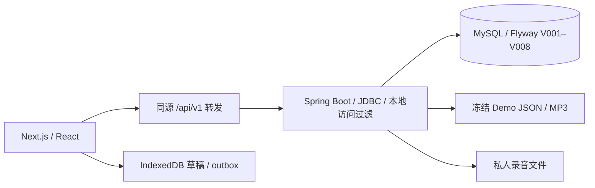

# Phase 10A · 01 真实架构审计

日期：2026-10-26。状态：设计提案，待人工审核。本轮只新增设计及阶段报告；不启动应用、不连接学习库、不执行迁移、不导入教材、不改业务代码。后文“拟”表示未实施。

## 1. 审计基线与证据边界

- 工作区：`/Users/wangshiqi/Project/NorthstarEnglish`；HEAD：`4497e96fb3685d3e54b3e0995b5868b2db41b3ab`；开始时 `git status --short` 为空。
- 已核对 `AGENTS.md`、`README.md`、`docs/IMPLEMENTATION_PLAN.md`、`docs/DEPENDENCIES.md`、`docs/progress/PHASE_09_R.md`；适用参考为 `references/phase1/Northstar_English_Phase1_桌面Web详细设计与验收.md` 和 `新概念英语_AI学习网站_竞品与PRD_V1.md` 的产品、教学、数据与音频约定。本轮不做像素设计，不读取原型二进制。
- 已核对 `docs/handoff/PHASE_09_R_ACCEPTANCE_REPORT.md`、`API_AND_DATABASE_SNAPSHOT.md`、`ARCHITECTURE_SNAPSHOT.md`、`TEXTBOOK_EXPANSION_ASSESSMENT.md`、`KNOWN_ISSUES.md`。资料实际存在，无需假设缺失的验收材料。
- 09-R 候选 `dd9e3f47a1a5c12296532846f676bb1fcbec7569` 的本地核心工程 PASS，是历史报告结果；本轮没有重跑其测试，也没有确认主库当前行内容。09-R 只读核对过 V008 元数据及 Flyway validate，不等于真实学习库全量一致已证明。
- 授权门禁 FAIL、实体麦克风/其他浏览器/另机 NOT VERIFIED 仍保留。旧 KNOWN_ISSUES 的工作区、测试缺口描述是原审计快照，以 09-R 的逐项关闭证据为补充，不能当作当前全部仍失败或全部已解决。

## 2. 已实现的数据链

配置基线：Java 21 / Spring Boot 4.1.1；Next 16.4.2 / React 19.3.1 / TypeScript 5.9.3 / Tailwind 4.3.3；Node 22/npm10；MySQL 8.4。来自 POM/package 配置和交接报告，不是本轮依赖安全或维护状态审查。保留锁文件，不为设计升级依赖。

## 3. 核心限制、实际依据与最小影响

以下 Java 路径均在 `apps/api/src/main/java/local/northstar/`；迁移在 `apps/api/src/main/resources/db/migration/`。

| 领域 | 实际代码依据 | 当前能力与限制 | 后续最小修改 |
| --- | --- | --- | --- |
| 课程 | `catalog/ContentPackage.java: publishedVersions/load/checkedAudio` | 固定 demo-01、版本<100、10句/10文件、四册仅目录，音频正则只01–10 | 保留冻结Demo适配器，增加通用包校验器与显式发布命令 |
| 启动 | `catalog/ContentSeeder.java: seed/verifyRows/seedReading/seedWriting/seedQuiz` | ApplicationRunner使用迁移数据源；启动事务会补已知内容、重设Demo当前指针；全局要求4册catalog_only，词条/题目/写作来源固定 | 拆分一次初始化、只读验证、显式发布；旧包不变；禁止启动覆盖发布指针 |
| 组织 | `V002` | book/lesson/version已存在；kind仅original_demo/licensed，audio source_kind仅original_tts/licensed_audio；Demo无book；无paragraph；stable_key仅版本内唯一 | 增加段落、稳定身份及版本映射，保留旧PK/FK |
| 音频 | `V002 sentence`、`CatalogController.lesson/audio` | start_ms=0；uq_sentence_audio全表唯一；接口检查每句文件，缺一个文件整课503 | 增量解除约束、共享音轨；拆文本可读与媒体可用性 |
| 播放 | Web `lib/media/AudioController.ts`、`MediaProvider.tsx` | Track只有id/uri；文件ended驱动换句，加载每句重设src，位置为句文件相对时间 | 增加片段边界，同源复用，时间坐标显式化 |
| 测验 | `V007 quiz_run`、`exercise/QuizReviewController.java: submit/QuizSubmit` | CHECK正确数0..3；DTO与服务强制3题；父事件派生子事件，事务入库 | 快照题集、动态题数、按历史答案回填分母 |
| 报告 | `report/ReportController.java: report/path` | quiz分母COUNT×3；逐版本多查询；浏览仅推断自当前resume；六路径/五训练固定，阅读历史无分页 | 从证据计算可变分母，按课/版本筛选和分页，能力层另列 |
| 阅读 | `exercise/ExerciseController.java: reading/readingAttempt` | 排除固定please词条，反馈固定beside/第6句；reading_question复合FK把一个知识点和一道题限制在同句 | 反馈来自题目包，多源句/多概念关联；旧主锚点保留 |
| 知识 | `V005 knowledge_point/reading_question`、`V007 quiz_question/review_item` | 词条绑定单课单版单句，无全局语义概念；复习来源有原attempt | 新增全局概念与出现位置，不改旧knowledge_point含义 |
| 听写 | `ExerciseController.attempt/command/target` | ID约定sentenceId-dictation；TokenAligner规则评分；audioPlayed/answerExposed为客户端报告；事件幂等 | 先保留兼容端点，通用题目按DB解析，评分算法版本不改 |
| 状态 | `V004/V005/V006/V007`及对应控制器 | 五态与历史证据分离；skip/pause/start不加尝试；practiced不等于答对 | 保留；可选教学步骤不增加假完成 |
| 录音/写作 | `practice/RecordingController.java`、`WritingController.java`、`PracticeCommands.java` | 私人文件与DB非原子；启动reconcile写状态；写作版本不可变、CAS草稿、当前取第一写作任务；录音限120秒/8MB | 历史完全保留；段落复述单独任务，不暗改旧录音上限；多写作任务用显式taskId |
| 恢复 | `study/StudyController.java: validate`、`V003/V004` | 一个local恢复点；位置上限600000ms，按end_ms校验，无坐标类型 | 保留最近入口，新增按课版本恢复点；旧positionMs解释为句内偏移 |
| 前端 | `CatalogPages.tsx`、`LessonWorkspace.tsx`、`context.ts`、`QuizPanel.tsx`、`LearningReport.tsx`、`ReadingQuestion.tsx`、`ReviewQueue.tsx` | Demo标题/版本按钮、ID后缀推算句序、3题、第6句、固定路径分母、空态Demo链接 | 由内容/步骤/sequence字段驱动；不重做视觉 |
| 数据工具 | `exportimport/ExportController.java: CONTENT/tables/preview`、`scripts/data-transfer.py` | 全表内存快照；同schema/同内容基线；JSON不含媒体与浏览器缓冲 | 新表必须分类并更新恢复依赖；跨schema先旧版恢复再迁移；教材导入另工具 |

## 4. 内容与测试基线

`content/demo-01/active.json` 为activeVersion=2、publishedVersions=[1,2]；v1/v2各10句、10音频、5词条、15条exercises（含3选择题、阅读/写作/逐句听写定义）。这些是两份内容版本，不是两节课。三条许可记录仍pending_review、releaseReady=false；四册144/96/60/48只是清单声明，不能据此声称已有348课正文。

真实测试源码：

- `catalog/{ContentPackageTest,CatalogIntegrationTest}`：冻结包、路径穿越/软链接/哈希、20句/20音频、重复播种、跨版FK、200/206/416/503。
- `exercise/{ExerciseIntegrationTest,ReadingIntegrationTest,QuizReviewIntegrationTest}`：并发幂等、错误无残留回执、草稿CAS、跳过不增计数、原始错误来源、翻卡到期/CAS/重启；Demo仍应恰有3题。
- `practice/PracticeIntegrationTest`：不可变作文、并发版本号、录音pending/missing/deleted与回放证据。Java的结构容器fixture不证明可解码音频。
- `report/ReportExportIntegrationTest`：真实SQL计数、六路径、设置CAS、同基线预检与密码排除；schemaVersion替换用例写死008，后续必须参数化且保留不同schema拒绝断言。
- `study/StudyIntegrationTest`：来源防护、恢复点CAS、外课/外句拒绝；Web `tests/{media,timeline,context,recorder,client,shuffle,formatTime}.test.ts` 是现有定向测试。

集成测试需要 `NORTHSTAR_DB_TEST=1` 且硬校验 `northstar_phase01_test`；不能直接指向个人学习库。普通verify跳过集成测试，不能用绿色退出码冒充真实MySQL通过。

## 5. 推荐与不采用方案

| 推荐决策 | 理由 | 暂不采用 |
| --- | --- | --- |
| 模块化单体/JDBC增量表 | 复用事务、复合FK、运行边界 | 微服务/MQ/图数据库：无当前必要性，增加恢复复杂度 |
| 旧版本不可变+新版本显式发布 | 保留事件、录音、作文语境 | 覆盖句文本、重建主库、改历史SQL：破坏可追溯性 |
| 关系表表达身份/关联，JSON承载版本化内容配置 | 可约束与可演进兼得 | 全部塞JSON：跨课统计/FK无法可靠保证；全量通用工作流引擎：过度设计 |
| 独立本地导入CLI，与学习数据恢复分开 | 无公网写入口，可审查、dry run | 启动扫描自动发布、浏览器直接写DB/放Key |
| 单音频片段适配器+原句文件兼容 | 同一播放器支持两种素材 | 为整课切出大量衍生文件作为唯一方案；现在引入流媒体服务 |

## 6. 风险与验收

风险：启动隐式写入、同名不同内容、旧外键断链、媒体非事务、版权未知、长期规模未知。保护与Go/No-Go见[04](04_MIGRATION_PLAN.md)、[08](08_TEST_AND_ACCEPTANCE_PLAN.md)、[09](09_PHASE10_IMPLEMENTATION_PLAN.md)。本轮验收只确认设计依据/文档一致及业务文件未变；运行能力均留给获批阶段实际验证。

## 7. 10A-R复审修订边界

2026-10-26：独立设计评审为CONDITIONAL PASS，保留上述架构结论，仅修正哈希关联、原创课/真人音频枚举、基础与完整教学计划发布契约、隔离迁移硬门槛，以及规范词条/10B拆分/边界测量。逐项响应见[10A_REVIEW_RESPONSE](10A_REVIEW_RESPONSE.md)。本修订开始时Git状态为九份设计文档及PHASE_10A.md未跟踪，并非干净工作区；第1节“开始干净”保留为原10A报告的历史陈述。本轮独立复核HEAD未变、已跟踪文件无差异，未验证真实DB状态或09-R运行结论。
