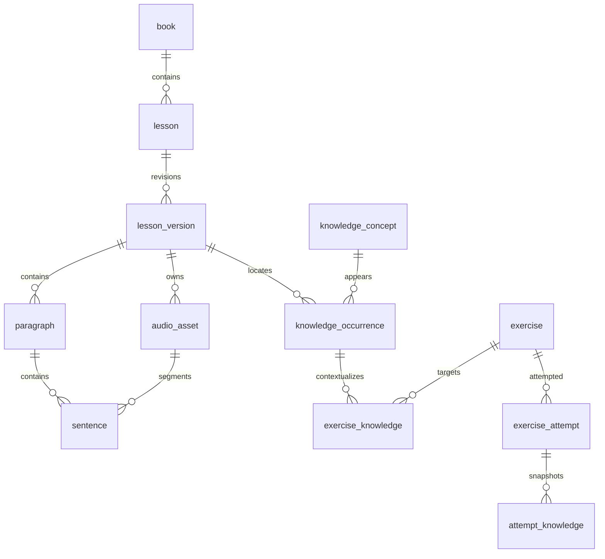

# Phase 10A · 03 目标数据模型

状态：逻辑设计，表名/迁移号为提案，不是已执行DDL。沿用MySQL/JDBC，ID字符串至多64字符、ASCII区分大小写；时间UTC。内容版本与学习记录均不破坏性重建。

## 1. 实际依据与组织关系

依据：V002的book/lesson/lesson_version/audio_asset/sentence及复合FK；V004作答/证据；V005单课知识点；V006作文/录音；V007测验与复习。当前没有段落、稳定身份注册、全局知识概念和题集快照。

Book是特定edition的册目录，不把edition_label当内容version。Lesson是该册中的稳定课程身份（Demo允许book_id=NULL）；Version是该课一次不可变发布快照；core-v1含文本、可选基础练习与音频对齐，teaching-v1才要求完整教学计划，二者不能混称完整闭环。相同课在不同教材edition默认是不同Lesson，可人工映射；不自动按课号或标题合并。

## 2. 核心对象与约束

| 表/对象 | 保留或新增字段/键 | 完整性/行为 |
| --- | --- | --- |
| book | 保留PK/catalog_key+edition_label；拟扩availability为catalog_only/available/withdrawn | 仅存在可学已发布课才可available；四册现有目录继续catalog_only；数量来自实际课，与declared_lesson_count分列 |
| lesson | 保留PK/slug/book_id/current_version_id；kind增量支持original_demo/original/licensed；新增book内排序与可选display_number | UQ(book_id,sequence_no)，独立课允许NULL；课号是展示值，不作主键；current仍复合FK属于本课；发布CAS锁定旧指针 |
| lesson_version | 保留PK、UQ(lesson_id,version_no)、hash/payload；新增schema_version、publication_state、published_at、content_readiness | draft/validated/published/withdrawn；content_readiness=basic_content/teaching_complete/legacy_unassessed，与生命周期及许可release_ready独立；core-v1只basic_content，teaching-v1且10F门禁通过才teaching_complete；历史Demo为legacy_unassessed；current只能指published，服务校验；历史Demo回填published但仍usageScope=local_test_only、release_ready=false；新教材发布必须通过许可门禁；不把历史pending_review更新成confirmed |
| paragraph | 新id/version_id/stable_key/sequence_no；UQ(id,version_id)、UQ(version_id,stable_key/sequence_no) | FK(version_id)→lesson_version；每版句必须属于同版段落；段落顺序与句序一致 |
| sentence | 旧PK、stable_key、全课sequence_no、文本与旧FK保留；新增可空paragraph_id→回填→NOT NULL | FK(paragraph_id,lesson_version_id)→paragraph(id,version_id)；Demo每版一个“原始对话”派生段落，不修改冻结payload；全课句序不因段落从1重置 |
| sentence_identity | 新id/lesson_id/registry_key；UQ(lesson_id,registry_key)、UQ(id,lesson_id) | 表示逻辑句身份，不是版本内物理句ID；新增sentence.identity_id并复合FK(identity_id,lesson_id)；旧stableKey只是候选映射，人工核对后登记 |
| paragraph_identity | 同sentence_identity模式 | paragraph增加identity_id与lesson上下文复合约束；插段不重排身份 |
| version_sentence_map | from_sentence_id/to_sentence_id/relation/mapping_group/reviewer/reason | 双端FK；relation=equivalent/edited/split/merged；同lesson校验，split/merged多行成组；删除只保留旧端并标无目标 |
| audio_asset | 保留版本/许可/哈希/存储键；source_kind增量支持original_tts/original_recording/licensed_audio；拟新增role=sentence/full_lesson | 每版至多一条主full_lesson（用独立主音轨关联实现），同版多句可引用；媒体不可原位替换 |
| lesson_audio | 新version_id PK/audio_asset_id；复合FK(asset_id,version_id) | 可选完整主音轨；Demo不强制拼接，仍使用旧句文件 |
| sentence.start_ms/end_ms | 改为0≤start<end；取消uq_sentence_audio | end≤asset.duration由导入/发布/服务校验（跨表不能靠单行CHECK）；详见[05](05_AUDIO_ALIGNMENT_DESIGN.md) |

版本内PK继续是实际学习记录的引用。新ID建议随机UUID字符串（36字符）或登记过的短opaque ID；不拼接多层路径以免超过64，不从内容hash/标题/序号派生身份。导入前登记映射表，重导使用同ID；同ID不同冻结内容必须冲突，改内容创建新Version。

### 2.1 V002类型约束的增量扩展（R2）

实际V002：`lesson.kind IN ('original_demo','licensed')`、`audio_asset.source_kind IN ('original_tts','licensed_audio')`，均为VARCHAR(24)+CHECK；`content_license.source_type IN ('original','licensed')`可保留。拟在10B-3的V009组独立迁移单元扩展前两项，分别增加 `original` 与 `original_recording`，不修改V002、不重命名历史枚举、不UPDATE旧行。新增值均适配现有列长，不使用original_demo冒充所有原创课程。

预检information_schema的实际CHECK名称与表达式，再以命名CHECK替换；检查单元中断状态及新旧值约束，保留NOT NULL/FK。DDL及应用DTO/Schema/校验器同一交付范围，但仍先走10B-1隔离演练。验收：三类课程×三类音频合法组合均可校验/入隔离库（许可匹配）；未知枚举及来源不匹配被拒；历史原值/ID/许可/hash不变。课程原创性与音频来源独立，不强制同类配对。新迁移范围及阶段见04/09。

## 3. 历史兼容与发布

1. 旧Demo所有lesson/version/sentence/audio/exercise/knowledge_point/event/attempt/revision/card ID保持原值；payload与manifest字节哈希不重写。
2. 新段落等是关系投影，不能声称存在于原冻结包。API响应可添加派生字段并标projectionVersion；旧hash校验仍对原字节。
3. 换音频/校正时间轴/改标准答案/拆句/改教学计划都创建新版本，保持一套简单发布语义；暂不再引入独立音频release体系。
4. 按content_readiness分别执行基础内容或完整教学计划门禁；不能把release_ready（许可发布条件）或published当作教学闭环通过。10E→10F补计划新建版本，不修改旧版就绪度/payload。发布验证成功后在短事务内更新version状态与current_version_id（对旧指针CAS），不移动历史学习记录。已有页面和待提交outbox固定旧版；旧版未撤回仍可继续作答。
5. 新版提示“有旧版学习证据”，只对人工equivalent映射显示参考，不复制practiced、correct、review_result或草稿。拆合句不能自动转移成绩。草稿迁移只能人工复制为新草稿且记录来源，不自动提交。
6. 撤回版本禁止新学习命令与媒体分发；已保存事件/作答/作文仍可读，内容展示受权利策略约束，可用占位说明。不得级联删除历史；媒体不可取得时仍显示原ID、版本、日期及不可用原因。

## 4. 练习及可变题量：先兼容，后扩展

保留 `exercise` 三种kind、`exercise_attempt` 及 `reading_question/quiz_question` 的原主锚点句/知识点FK。新增关系支持多源上下文，暂不放松旧NOT NULL/FK以制造无来源题目。

| 新增/扩展 | 建议关键字段与关系 | 意义 |
| --- | --- | --- |
| exercise_sentence | PK(exercise_id,sentence_id)，version_id/role；复合FK到exercise(id,version_id)和sentence(id,version) | 多句阅读/复杂句题；原sentence_id是定位主锚点，不能把其余证据句丢掉 |
| exercise_set / exercise_set_item | set.id/version_id/purpose/protocol_version/context_group_id；item PK(set_id,exercise_id)、UQ(set_id,ordinal)；同版复合FK | purpose=practice/diagnostic/immediate/delayed/transfer；不可变题集，n可为1..100；无题不创建可提交题集 |
| quiz_run扩展 | total_count/submitted_count、set_id可空、set_hash、exposure_status、measurement_policy_version | 历史按quiz_answer实际数量回填；新完整提交要求submitted=total>0且correct≤submitted；不存可漂移百分比 |
| quiz_run_item | PK(run_id,exercise_id)、ordinal；同版FK到run/exercise | 保存本轮题目集合；旧轮从答案恢复；不能按“当前题集长度”重算历史 |
| attempt_context | attempt_id PK/FK；purpose/protocol_version/context_group_id/text_exposure/answer_exposure/hint_used/server_started_at | 新评量条件；历史缺失=unknown，不假设独立；服务器控制复测间隔 |

V007去掉了uq_exercise_target，已允许同句同kind多题，不能重新加回。拟新增UQ exercise(id,version_id)供链接引用；choice主锚点仍必须是真实证据句（可多句），不建立伪造“整课句”。段落写作使用已有writing_task与多源writing_source；复述/人工文本任务使用显式task，见下文。

完整交卷协议：客户端提交setId、setHash、answers和eventId；服务端取冻结集合，要求key集合完全相等、每题有效选项、无额外题/漏题。不接受客户端总题数/正确数。N=0为无练习，不能提交空卷；skip/pause不建run；部分答案仅草稿。本轮成功一次父命令、N个稳定派生子事件、N个attempt/evidence，事务统一；同event原响应重放，同ID改payload为409。

## 5. 全局知识点与跨课来源

不直接把旧knowledge_point改成全局表，它实际是课内词条，会破坏V005/V007同句FK。

| 表 | 主键/唯一键与关联 | 规则 |
| --- | --- | --- |
| knowledge_concept | id PK；UQ(kind,canonical_key,sense_key)；kind=vocabulary/grammar/collocation/pattern | 同形词不同义项分开；canonical_key为VARCHAR(255) utf8mb4区分大小写的规范文本（NFC、首尾去空白、连续空白折叠，保留大小写/标点），允许空格/撇号/连字符；id才是稳定ASCII标识，sense_key区分义项；人工维护，不按term自动合并；描述修订有审校记录 |
| knowledge_occurrence | id PK、concept_id、lesson_id/version_id、scope、paragraph_id可空、sentence_id可空、usage_json；UQ(id,version_id,concept_id) | FK(version,lesson)及段/句同版；scope=lesson/paragraph/sentence用CHECK控制空值；句出现还核对其段落；允许同概念在多课多句出现 |
| legacy_knowledge_link | knowledge_point_id PK、occurrence_id UNIQUE、version_id/sentence_id/concept_id | 双端复合FK，保证映射的是旧词条原位置；无明确义项先不合并，不改旧收藏/错题 |
| exercise_knowledge | PK(exercise_id,occurrence_id)，version_id/concept_id/role | 复合FK到exercise和occurrence；role=target/support；不把所有词条都当测量目标 |
| attempt_knowledge | PK(attempt_id,occurrence_id)，exercise_id/version_id/concept_id/role | 补UQ exercise_attempt(id,exercise_id,version_id)，FK与exercise_knowledge组成防串课链；提交事务内从冻结题目关系快照，不信客户端conceptId |
| concept_review_card/source | card PK/id，UQ(owner_key,concept_id,prompt_kind,protocol_version)；source PK(card_id,attempt_id,occurrence_id) | source通过attempt_knowledge复合FK到真实作答与原出现位置；卡可跨课，来源不可丢；旧review_item不迁走/不重置到期 |
| concept_review_result | event_id PK→command_receipt；card_id、CAS前版本、rating/next_due | 自评排期；客观复测仍生成exercise_attempt，经source关系回链，两者分列 |

新跨课卡与旧句卡不共用V007的同句FK，避免把跨课来源强行塞到一个sentence_id。复习队列可分组显示旧句卡与概念卡；合并展示去重但保留每次来源、原版、题目和attempt。知识概念改名/合并只追加关系与审校，历史按当时概念关联快照可追溯，不能凭新词义篡改旧评量。

## 6. 任务编排与输出评审

10F新增最小关系，不开发通用BPM引擎：

- `learning_plan`：id/version_id/plan_version/payload_hash、配置JSON；`learning_step`：id/plan_id/phase/required/order/config。`step_dependency`带同plan FK且发布检查无环。
- `learning_task`：id/version_id/kind（exercise_set/writing/recording_output）、可空set_id/writing_task_id，CHECK恰选与kind相符的来源；录音输出使用独立任务配置。复述可锚定真实课/段/源句，无需伪句。
- `step_task`：step/task同版关联；`plan_instance`：id/plan_id/selection_json/hash，冻结学生选择；`step_progress`：instance/step五态。计划变化不重写旧实例。
- `task_evidence`：id/task_id/instance_id及attempt_id、writing_revision_id、recording_event_id三选一，均FK；服务校验证据真实上下文与task类型。与已有learning_evidence引用相同来源，报告按原source ID去重，不重复算两次。
- `output_submission`：id/event_id/task_id/version_id/source_sentence集合，关联一份writing_revision或一份录音；段落录音的主句只是导航锚点。10F如需超过120秒必须另审容量，不悄悄扩大旧上传协议。
- `output_assessment`：id/event_id/submission_id/rubric_version/rater/payload/assessed_at，追加不可变。没有人工评分时只存输出证据，不填写correct=true或模型分数。

## 7. 修改范围、风险与验收

新增关系和必要索引、扩展DTO/查询/导入分类；不重写V001–V008、不放开runtime更新学习历史权限。新增表按内容/学习/导入审计分组纳入备份；每表有PK。

风险：表间冗余上下文、旧映射误判、长ID、题集/计划分母漂移。验收：跨课/跨版FK负例、同义项多课正例、拆合句不转移成绩、旧版outbox重试、N题原子提交、同基线导出恢复、新版发布不动旧证据。完整迁移/验收见[04](04_MIGRATION_PLAN.md)和[08](08_TEST_AND_ACCEPTANCE_PLAN.md)。

音频对齐记录的audioSha256、transcriptSha256、transcriptNormalization及有序sentenceIds须持久化到版本payload/对齐元数据；按06第4.1节分别核验实际文件和对应转录，不比较两类哈希相等。
